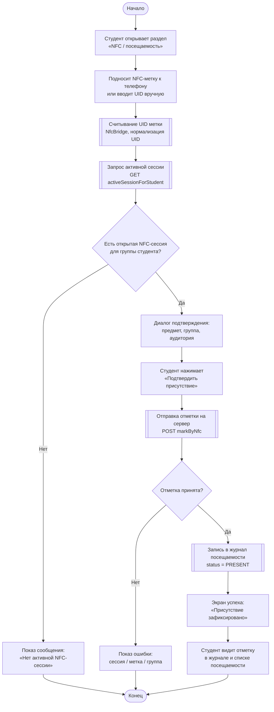
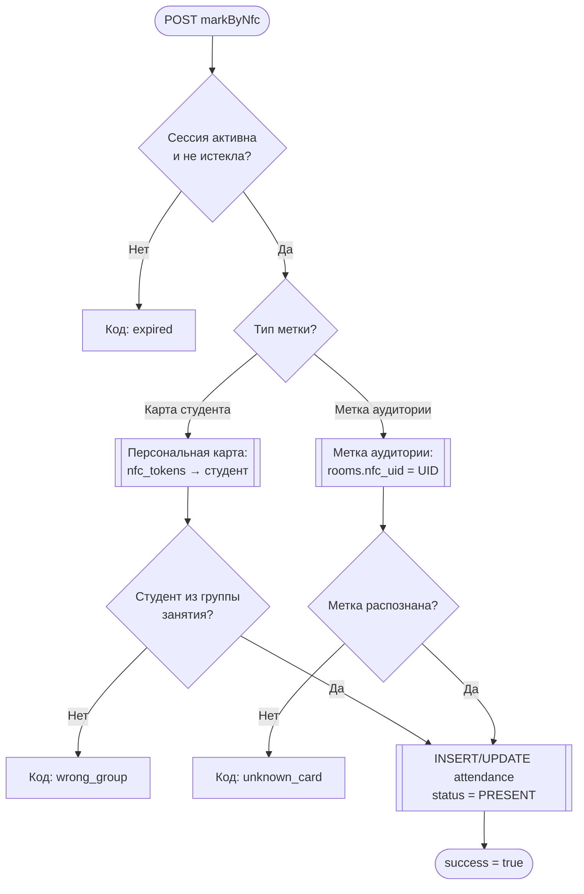

# Диаграмма деятельности: чекин студента на лекции (NFC)

Логика соответствует коду:
- клиент: `NfcScanViewModel` (`onStudentTagRead`, `confirmStudentPresence`);
- сервер: `AttendanceService.activeSessionForStudent`, `AttendanceService.markByNfc`.

**Нотация (как в примере с переносом пары):**

| Фигура | Значение |
|--------|----------|
| Овал | Начало / конец |
| Прямоугольник | Действие пользователя |
| Прямоугольник с двойной рамкой | Автоматическое действие системы |
| Ромб | Условие (Да / Нет) |

**Предусловие:** преподаватель уже открыл NFC-сессию на паре (отдельная диаграмма).

---

## Основная диаграмма (студент)

Скопируйте в [mermaid.live](https://mermaid.live) для экспорта в PNG/PDF.



---

## Детализация проверок на сервере (markByNfc)



---

## Текстовая схема (как на рисунке-образце)

```
                         ┌─────────────┐
                         │   Начало    │
                         └──────┬──────┘
                                │
                   ┌────────────▼────────────┐
                   │ Студент открывает NFC   │
                   └────────────┬────────────┘
                                │
                   ┌────────────▼────────────┐
                   │ Подносит метку или      │
                   │ вводит UID вручную      │
                   └────────────┬────────────┘
                                │
          ╔═════════════════════▼═════════════════════╗
          ║ Считывание UID, запрос сессии             ║
          ║ activeSessionForStudent                   ║
          ╚═════════════════════╤═════════════════════╝
                                │
                         ◇ Сессия есть? ◇
                         Нет ╱    ╲ Да
              ┌───────────╱        ╲──────────────────┐
              │                                       │
   ┌──────────▼──────────┐              ┌──────────────▼──────────────┐
   │ Сообщение: нет      │              │ Диалог: предмет, группа,    │
   │ активной сессии     │              │ аудитория                   │
   └──────────┬──────────┘              └──────────────┬──────────────┘
              │                                        │
              │                         ┌──────────────▼──────────────┐
              │                         │ «Подтвердить присутствие»   │
              │                         └──────────────┬──────────────┘
              │                                        │
              │          ╔═════════════════════════════▼═════════════════════════════╗
              │          ║ markByNfc: сессия, метка, группа → запись PRESENT       ║
              │          ╚═════════════════════════════╤═════════════════════════════╝
              │                                        │
              │                                 ◇ Успешно? ◇
              │                              Нет ╱    ╲ Да
              │                   ┌───────────╱        ╲──────────────┐
              │                   │                               │
              │        ┌──────────▼─────────┐    ╔══════════════════▼══════════════════╗
              │        │ Ошибка на экране   │    ║ Запись в журнал, экран успеха       ║
              │        └──────────┬─────────┘    ╚══════════════════╤══════════════════╝
              │                   │                               │
              └───────────────────┼───────────────────────────────┘
                                  │
                         ┌────────▼────────┐
                         │ Студент видит   │
                         │ отметку в       │
                         │ журнале         │
                         └────────┬────────┘
                                  │
                         ┌────────▼────────┐
                         │     Конец       │
                         └─────────────────┘
```

---

## Таблица исходов

| Этап | Условие «Нет» | Результат |
|------|----------------|-----------|
| Активная сессия | Нет сессии для группы | «Сейчас нет открытой NFC-сессии…» |
| markByNfc | Сессия закрыта / истекла | `expired` |
| markByNfc | Другая группа | `wrong_group` |
| markByNfc | Метка не привязана | `unknown_card` |
| markByNfc | Всё верно | `success`, в БД `PRESENT` |

---

## Связь с переносом пары (контекст)

| Роль | Действие до чекина студента |
|------|-----------------------------|
| Преподаватель | Открывает пару → «Начать занятие» → NFC-сессия активна |
| Студент | Только после этого проходит сценарий на диаграмме выше |
